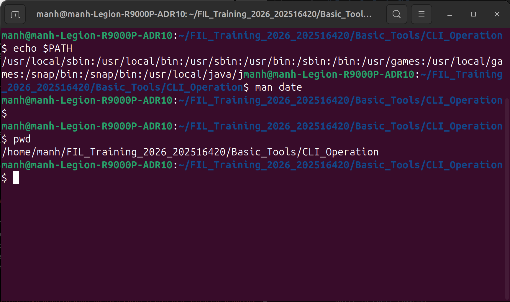
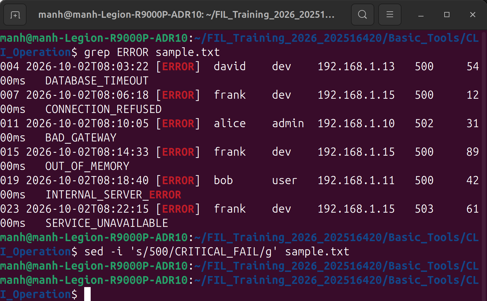
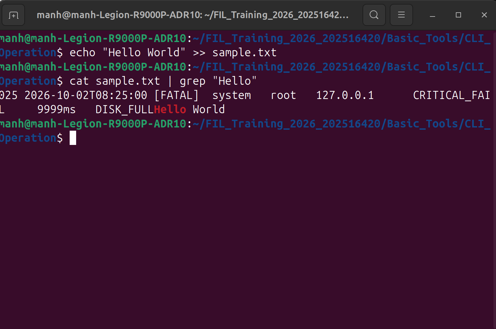
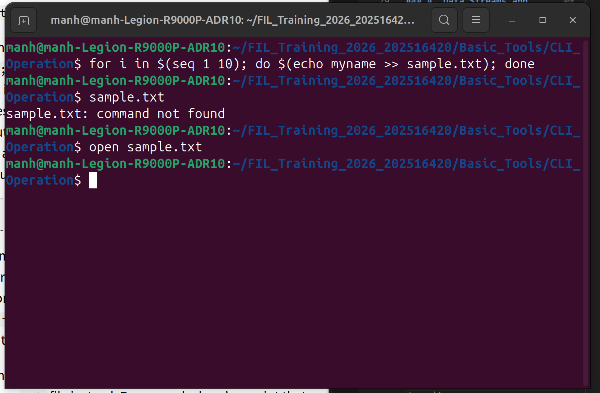

# Topic 2: Basic CLI Operation and the Shell Environment

### We are about to work with Bash - the core command-line interface on Linux. Instead of relying on a GUI, the Shell provides powerful capabilities for automating tasks and combining programs.

### 1. Navigation and Basic Operations

* **Shell Prompt:** Understood the structure of the prompt (e.g., `missing:~$`), where `~` represents the home directory and `$` indicates a standard user privilege (non-root).
* **Paths:** Differentiated between **Absolute paths** (starting with `/` from the root) and **Relative paths** (relative to the current directory). Mastered the two special symbols: `.` (current directory) and `..` (parent directory).
* **Core Commands:**
  * `pwd`: Prints the current working directory (or use `echo $PWD`).
  * `cd`: Changes the directory. This is a built-in shell command, not a standalone program.
  * `man`: Opens the manual pages to look up usage instructions and flags for any command.

### 2. Environment and Program Execution
* When typing a command (e.g., `echo`), the Shell does not automatically know where the program is located. It searches within the **`$PATH`** environment variable—a colon-separated (`:`) list of directories.
* The `which` tool helps determine the exact file path of the executable being called.

### 3. Core Data Processing Tools
* **Reading and Manipulating Files:** `cat` (prints content), `head` / `tail` (prints first/last lines), `sort` (sorts lines), `uniq` (removes consecutive duplicate lines).
* `grep`: Searches for lines containing specific strings or Regular Expression patterns within one or multiple files.
* `find`: Recursively searches for files/directories based on specific conditions. For example: finding `.py` files or files larger than 100MB.
* `sed` **(Stream Editor):** Programmatically edits files (e.g., replacing all instances of 'A' with 'B' using the syntax `s/pattern/replacement/g`).
* `awk`: A programming language designed for parsing and extracting column-based data (e.g., from CSV or log files).

### 4. Data Streams and Pipes
* **Redirection:** Controls standard input/output (stdin, stdout).
  * `>`: Overwrites the program's output to a file.
  * `>>`: Appends the output to the end of a file.
  * `<`: Uses file content as input for a program instead of keyboard strokes.
* **Pipe Operator (`|`):** Connects the standard output (stdout) of the preceding program to the standard input (stdin) of the following program, allowing for the creation of chained data processing pipelines.

### 5. Shell Scripting
* The Shell is essentially a fully-fledged programming language (featuring variables, `for`/`while` loops, and `if` conditional statements).
* **Shebang (`#!/bin/bash`):** Placed on the first line of a `.sh` file to tell the system which interpreter to use to run the script.
* **Strict Mode (`set -euo pipefail`):** A crucial scripting practice to catch errors early: exits the script if any command fails (`-e`), crashes if an undefined variable is used (`-u`), and catches failures within pipe sequences (`pipefail`).
* **Command Substitution (`$()`):** Takes the output of a command and places it inside another command (e.g., `for i in $(seq 1 10); do...`).

