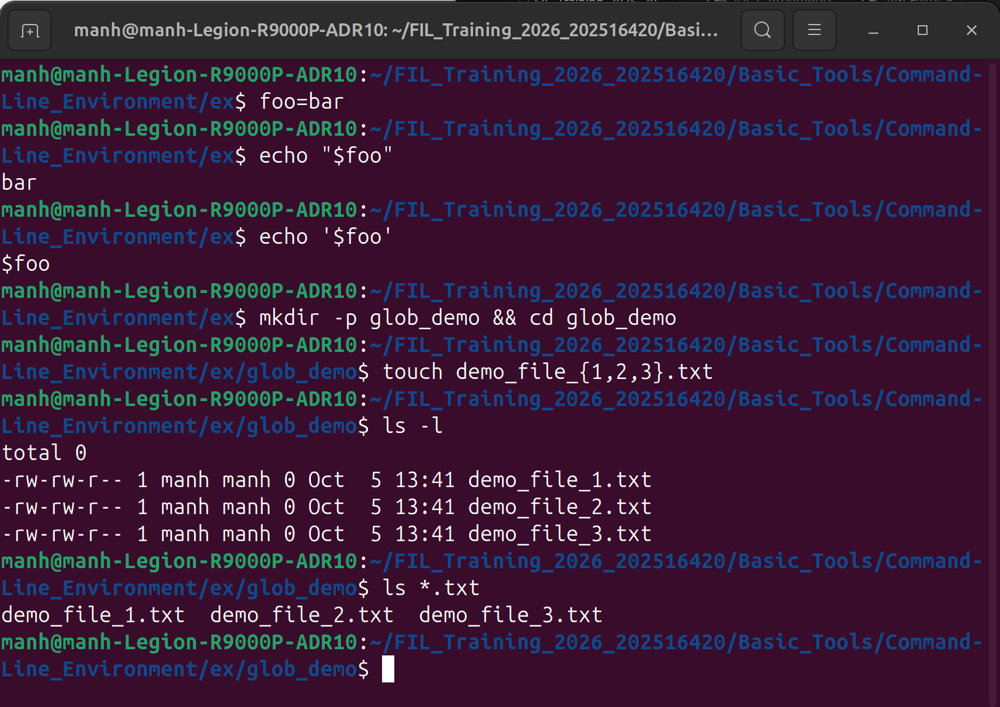
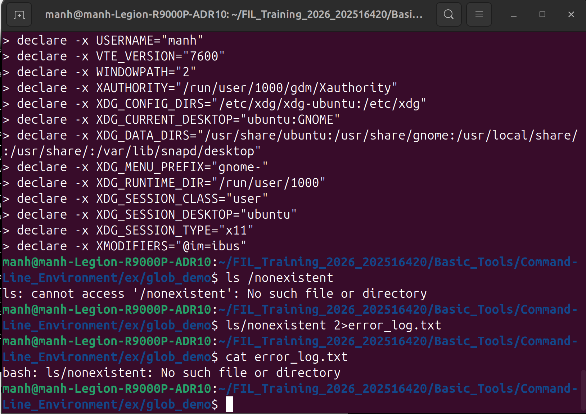
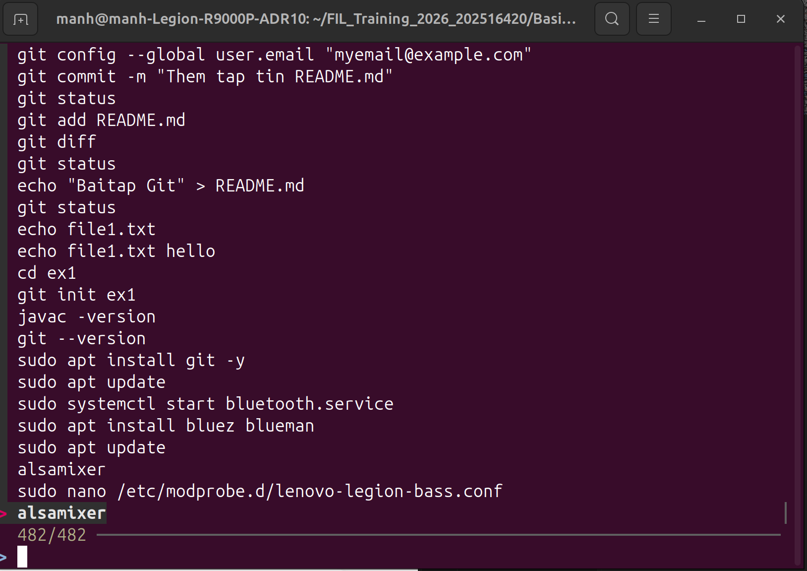
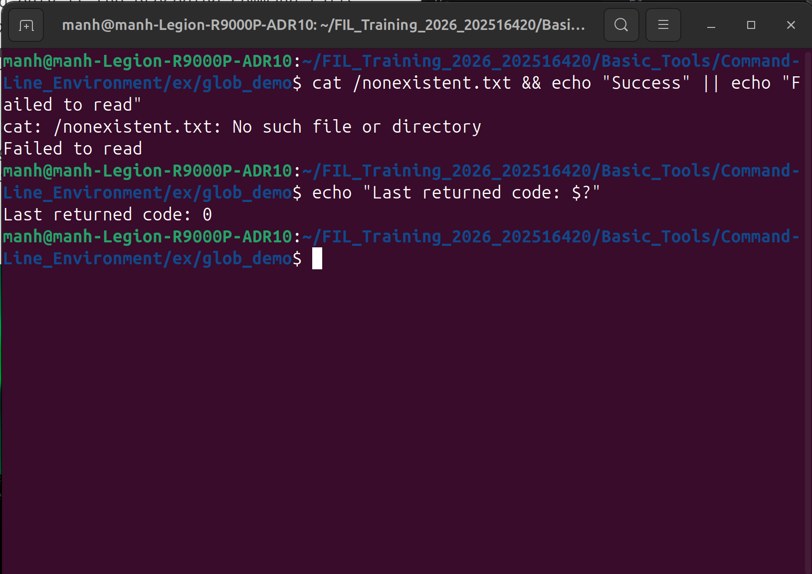
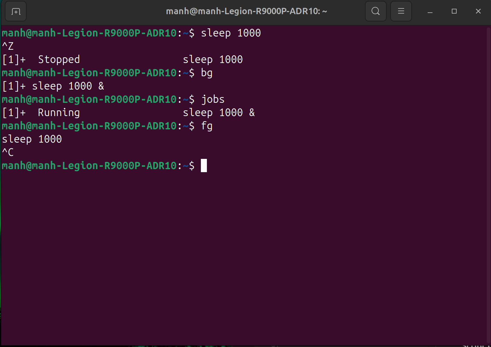
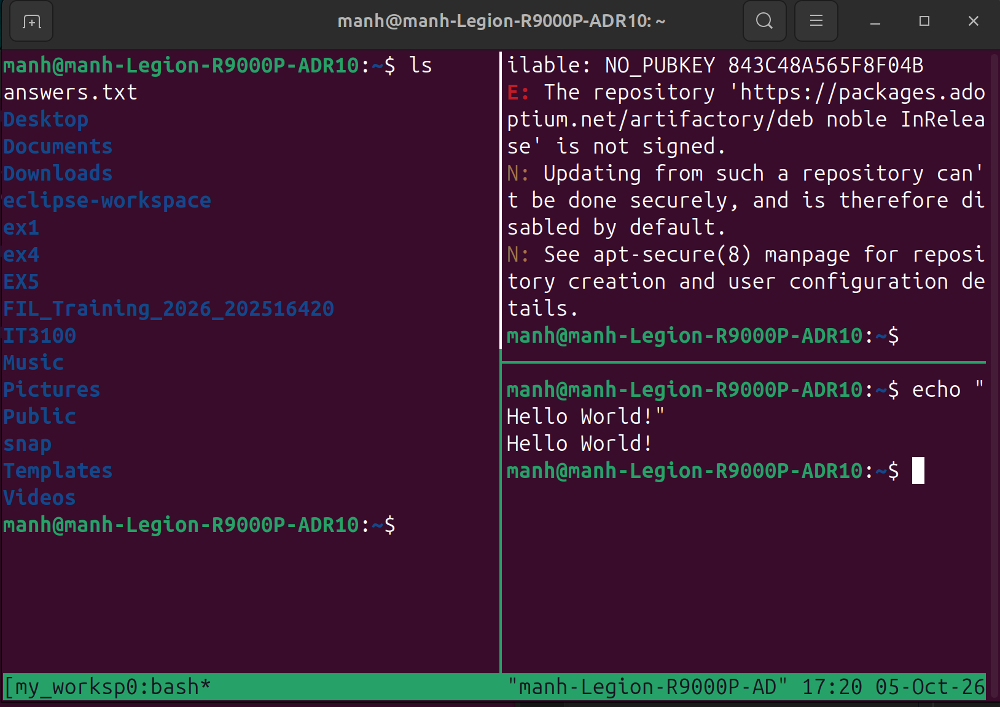

# Lecture 2: Command-Line Environment, Scripting, and Remote Access

### The shell is a full progamming language based on standard Unix conventions.

## 1. Arguments and Globbing

### Agruments and Variables

* Shell programs receive arguments as plain strings. The program determines how to intepret them.
* `$1` through `S9` for positional arguments, `$0` for the script/program name, `$@` for listing all arguments, `S#` for `sizeofarray`
* Flags modify program behavior and are preceded by a single dash (`-`) or double dash (`--`). Long format (`--all`) and short format (`-a`) are equivalent. Single-dash flags can be grouped together (e.g., `ls -l -a` is equivalent to `ls -la` or `ls -al`).
* Variable numbers of arguments of the same type is allowed in a single operation.
* The `--` flag is a special argument that tells the program to stop parsing flags, treating everything after it as positional arguments (e.g., `touch -- -myfile` allows creating a file starting with a dash)

## Globbing (Pattern Expansion)

* `*` (matches zero or more characters of any type)
* `?` (matches exactly one character)
* `{}` expand a list of patterns into distinct arguments (e.g.,`{a,b,c}.py`)
* Multiple globbing techniques can be combined
(e.g., `mv *{.py,.sh} folder`)

## 2. Streams, Redirection and Fuzzy Finding

## Concurrency in Pipelines

* All programs in the pipeline execute simultaneously.
* (`stdout`) of one program directly connected to the standard input (`stdin`) of the next program.

### Standard Streams & Redirection

* Three standard streams: `stdin`, `stdout`, `stderr`
* The `-` character is commonly accepted as "read from standard input".
* Output redirection operators: `>`, `>>`, `>`, `2>` (redirect stderr to file), `&>` (redirect both stdout and stderr).

### Interactive Filtering `FZF`

## 3. Environment Variables, Process Substitution, and Return Codes

### Variable Assignment & Quoting Rules

* Variables are assigned using `foo=bar` without spaces.
* Single quotes `' '` define literal strings. Double quotes `" "` allow variable expansion and string interpolation.

### Command & Process Substitution

* Command substitution (`$(CMD)` or `` `CMD` ``) captures the standard output of a command into a variable.

* Process substitution (`<(CMD)`) executes `CMD`, places its output into a temporary file, and substitutes `<()` with that temporary file's path.

### Environment Variables
* Environment variables are passed to child processes spawned by the shell.
* Prepending a command with a variable sets it exclusively for that child process execution.
* The `export` command updates the current environment so all subsequent child processes inherit the variable.
* Environment variables can be viewed with `printenv` and removed with `unset`.

### Return Codes & Short-Circuit Logic
* `0` indicates success, others mean error.
* Most recent exit code is stored in the `$?`
* `&&`: executes the subsequent command only if the preceding command succeeds.
* `||`: executes the subsequent command only if the preceding command fails.
* Conditional statements like `if` and `while` make control flow decisions directly based on program return codes.

## 4. Signals, Job Controls, Traps

### Signals
* Signals interrupt process execution to alter flow or terminate programs.
* `Ctrl-C` - `SIGINT` - Interrupt request.
* `Ctrl-\` - `SIGQUIT` - Quit request.
* `Ctrl-Z` - `SIGTSTP` - Terminal stop
* `SIGTERM` - Graceful exit.
* `SIGKILL` - Forceful exit.

### Job Management & Backgrounding
* Appending `&` to a command makes it run in the background.
* `bg`, `fg`: resume suspended processes.
* `jobs` list unfinished task.
* Closing a terminal sends `SIGHUP` to all child processes. This can be prevented by using `nohup` or `disown`.

### Script Cleanups
* `trap` executes cleanup routines upon receving spefic signals or when a script exits.

## 5. Remote Machines (SSH) and Terminal Multiplexers

### Secure Shell (SSH)
* Connect to remote systems interactively using `ssh user@host`.
* Run non-interactive commands remotely while piping input/output locally (e.g., `ssh user@host 'ls | wc -l'`).
* Public-key authentication uses key pairs generated via `ssh-keygen` (e.g., `ed25519` keys) and authorized via `~/.ssh/authorized_keys`.
* File transfers: `scp` transfers files over SSH, while `rsync` is an alternative that optimizes transfers.
* Custom host configurations are managed in `~/.ssh/config`.

### Terminal Multiplexers (`tmux`)
* `tmux` enables persistent terminal sessions, window tabs, and split screen panes, keeping remote sessions alive even if the network disconnects.
* All `tmux` commands use the default prefix shortcut `<C-b>` (Ctrl+b).
* **Hierarchy:**
  * **Sessions:** Independent workspaces created with `tmux new -s NAME`, detached with `<C-b> d`, listed with `tmux ls`, and reattached with `tmux a -t NAME`.
  * **Windows:** Tabs within a session created with `<C-b> c` and navigated using `<C-b> n` (next) or `<C-b> p` (previous).
  * **Panes:** Screen splits created with `<C-b> "` (horizontal split) or `<C-b> %` (vertical split).

  

## 6. Shell Customization, Dotfiles, and AI Integration

### Dotfiles & Environment Customization
* Tools and shells are configured using hidden text files known as "dotfiles" (e.g., `~/.bashrc`, `~/.gitconfig`, `~/.vimrc`).
* Storing dotfiles promotes fast setup across different machines.

### Modern CLI Alternatives & Aliases
* Modern alternative tools: `ripgrep` (`rg`) replaces `grep`, `fd` replaces `find`, and `tldr` provides concise, example-focused documentation instead of dense `man` pages.
* Use `alias` to create command shortcuts or set safer defaults (e.g., `alias mv="mv -i"` or `alias mkdir="mkdir -p"`).
* Prepend a backslash (`\ls`) to bypass an active alias and run the original binary.

### AI Integration in the Shell
* **Command Generation:** Generate complex CLI commands from natural language descriptions (e.g., `llm cmd "find python files modified last week"`)[cite: 3].
* **Pipeline Integration:** Extract structured data from complicated dataset.
* **AI Meta-Shells:** Interactive agents translate high-level intent into multi-step shell operations and file modifications.

