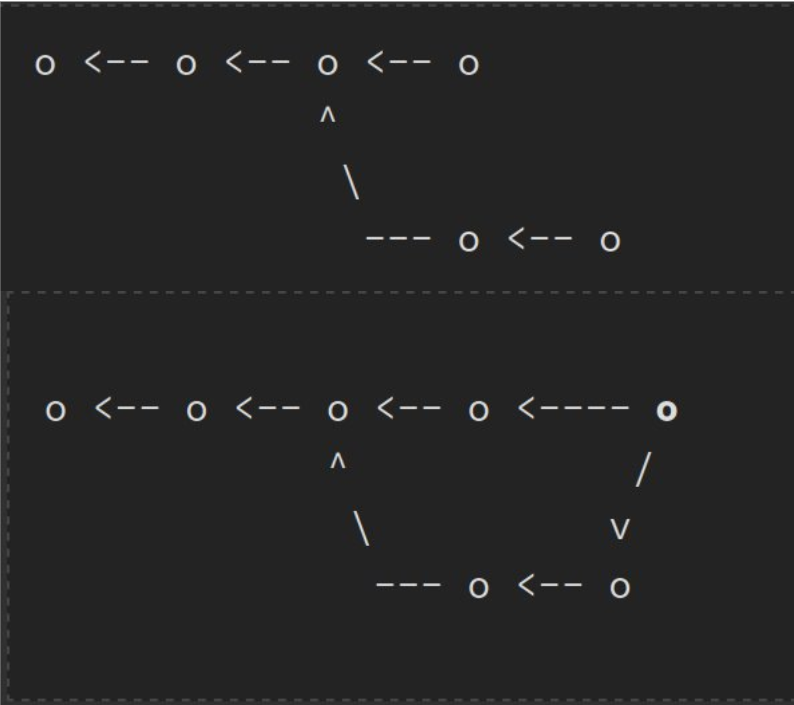
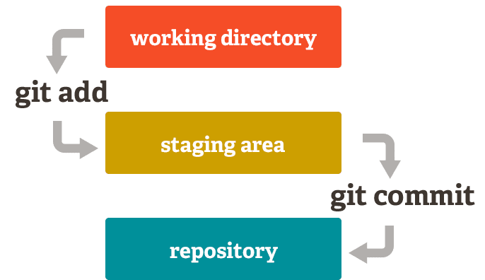
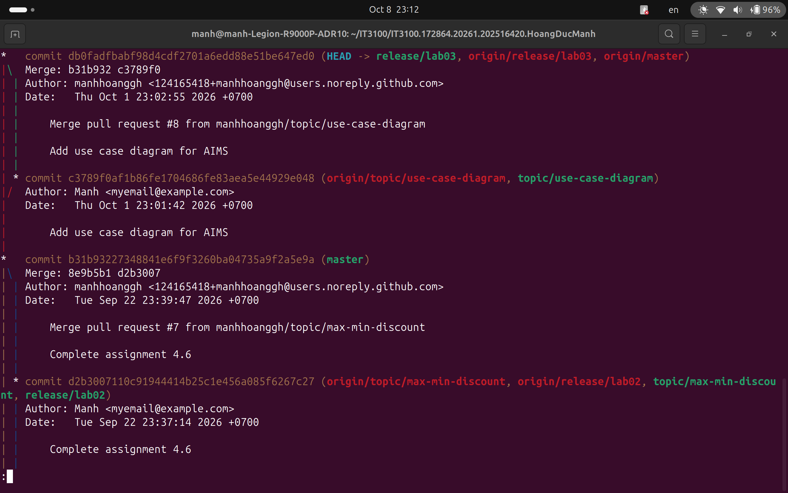
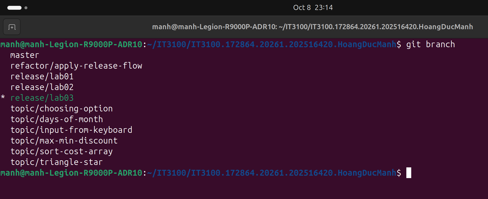
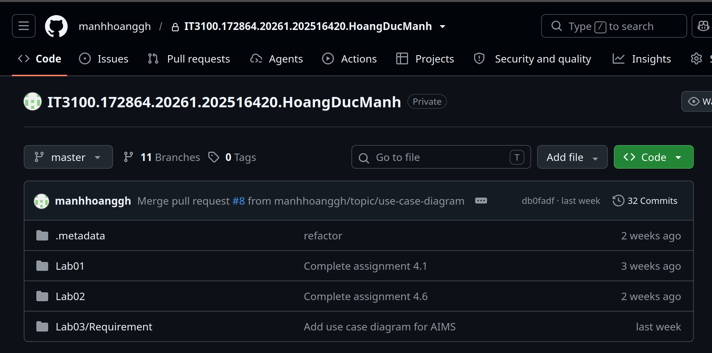

# Topic 3: Version Control Systems & Git

#### < Since I've approach it through OOP, I would take a more brief note on this topic >

Version control systems  track changes to source code over time, maintaining a complete history of project snapshots.

## 1. Git's Data Model:

History = sequence of top-level directory snapshots.

### Data Types
* **Blob (File)**
* **Tree (Directory)**
* **Commit**

### Content-Addressed Storage
Every object in Git (blobs, trees, commits) is identified and retrieved by its **SHA-1 hash** . Changing a single byte in a file creates a completely new blob with a new hash.

## 2. Modeling History

Git structures commit history as a **Directed Acyclic Graph (DAG)**. Each commit points backwards to its parent commit(s).

### Commit History & Merging
* **Sequential Commits:** Single parent references.
* **Branching:** Multiple child commits pointing back to the same parent.
* **Merging:** A merge commit pointing back to *multiple* parent commits simultaneously.

## 3. References and HEAD

 SHA-1 hashes are difficult to remember.
 
  Solution: **References (Refs)**: mutable human-readable pointers to commit hashes.

* **Branches:** Pointers to the latest commit in a line of development (e.g., `main`, `feature-auth`).
* **HEAD:** A special reference indicating your **current location** in the commit graph.

## 4. The Staging Area Architecture

Git separates file state into three primary areas before a snapshot is persisted to disk.

Staging area allows to choose which files are about to commit.

## 5. Command-Line Operations Map

### A. Repository Basics & Inspection
* `git init`: Initializes a new Git repository.
* `git status`: Shows current state (untracked/modified/ staged).
* `git add <file>`: Add file to staging area.
* `git commit -m "msg"`: Commit.
* `git log --all --graph --decorate --oneline`: creates a visual, color-coded, and compact ASCII tree graph of repo.

### B. Branching & Merging
* `git branch <name>`: Creates a new branch.
* `git switch <name>` (or `git checkout <name>`): Moves `HEAD` to point to a different branch.
* `git switch -c <name>`: Creates and switches to a new branch.
* `git merge <branch>`: Combines history from the target branch into the current branch.
* `git rebase <base>`: Rewrites commit history by applying current branch commits on top of another base commit.

### C. Remote Repositories & Collaboration
* `git remote add <name> <url>`: Links to a remote server (e.g., GitHub).
* `git push <remote> <branch>`: Uploads local objects and updates remote references.
* `git fetch`: Downloads objects and refs from the remote repository without merging.
* `git pull`: `git fetch` + `git merge`.

### D. Undoing Changes & Recovery
* `git restore <file>`: Discards uncommitted changes in the working directory.
* `git reset HEAD <file>`: Removes a file from the staging area without losing local edits.
* `git commit --amend`: Replaces the tip of the current branch with a new commit.
* `git revert <commit>`: Inverses the changes by a previous commit.
* `git stash`: Temporarily shelves modified, tracked files to clean your working directory.
