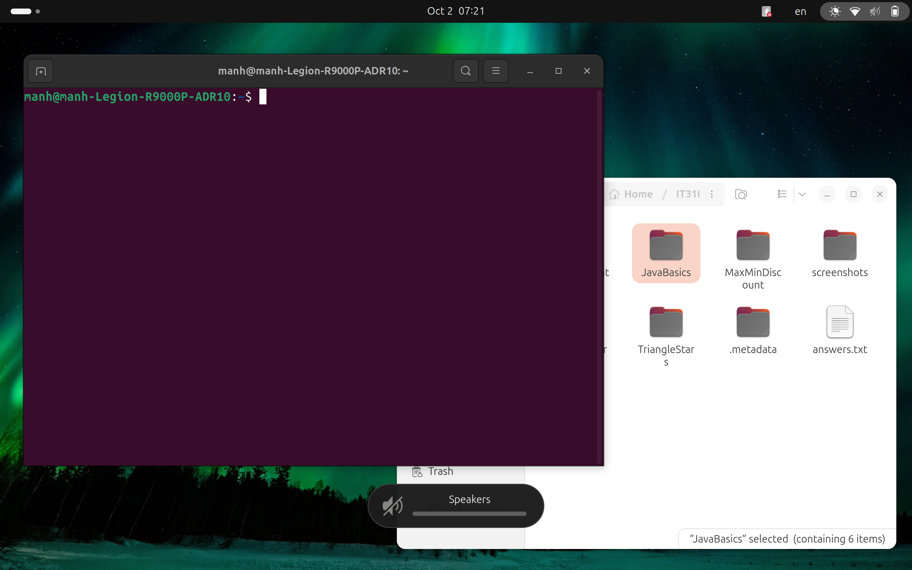

# Topic 1: Linux Installation

### Dual Boot (Windows and Linux) is implemented in this training. This is the recommended approach to maximize hardware performance and get the most native experience.

### 1.Core Knowlege Gained
* **Boot Mechanisms and Firmware:** Understood the differences between UEFI and Legacy BIOS, as well as how the EFI System Partition (ESP) works to store the bootloaders for both operating systems.
* **Safe Disk Partitioning:** Mastered the GPT disk structure. Specifically, I learned how to use the Disk Management tool on Windows to safely Shrink Volume without affecting existing data.
* **Bootloader Functionality:** Comprehended the role of the GRUB Bootloader—the startup manager that takes over the system after powering on, allowing the user to select either the Windows or Linux partition to boot into.

### 2. Practical Experience & Troubleshooting
During the installation on my personal devices,I encountered and resolved the following issues:
* **BIOS/UEFI Configuration:** It is mandatory to disable **Secure Boot** and Windows' **Fast Startup** before installing. This allows the machine to easily recognize the bootable USB and prevents future Linux kernel driver conflicts.
* **Time Synchronization Issue:** After setting up Dual Boot, Windows and Linux often display different times (usually offset by a few hours). This happens because Linux assumes the hardware clock (RTC) is set to UTC, while Windows assumes it is set to Local Time.

---
*Upcoming content regarding Linux CLI, Git, and basic coding environment setup will be updated in the following sections.*