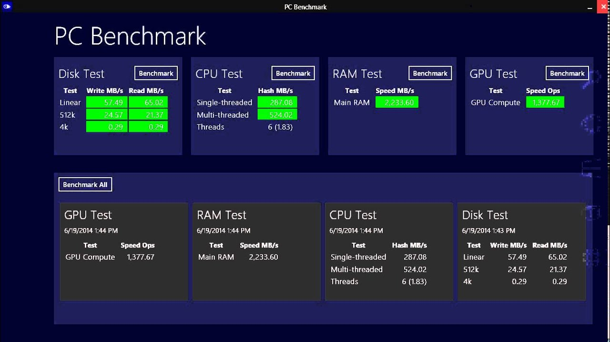

# Active Benchmarking

## 1. Core Philosophy & Concepts
* **Casual Benchmarking Trap:** Casual benchmarking occurs when you benchmark *A*, actually measure *B*, and incorrectly conclude you've measured *C*.
* **Passive Benchmarking:** Executing test suites in a "fire-and-forget" style and merely collecting final numerical outputs. This provides raw data without supporting technical evidence, frequently leading to poor architectural choices.
* **Active Benchmarking:** Analyzing system and application performance *while* the benchmark runs using diagnostic monitoring tools. This turns raw metrics into actionable technical information by confirming what is actually being tested and identifying true limiting factors.

---

## 2. Core Execution Methodology
1. **Steady-State Duration:** Adequate runtime required.
2. **Pre-Execution Source Code Analysis:** Inspect benchmark configurations, source code, Makefiles, and compiler flags beforehand to understand the exact workload design.
3. **Real-Time Component Analysis:** Observe while the workload executes to isolate the true system bottleneck.

---

## 3. Recommended Tools & Methodologies
* **Framework:** Use structured diagnostic methodologies like the **USE Method** (Utilization, Saturation, and Errors) to systematically identify hardware and software resource limits.
* **OS Diagnostic Toolkit:**
  * **System Statistics:** `vmstat`, `iostat`, `mpstat`, `sar`, `top` .
  * **Tracing & Profiling:** `perf`, `bcc/eBPF`, `DTrace`, `SystemTap`, `strace`/`truss`.
  * **Process & Thread Inspection:** `pidstat` (Linux) or `prstat` (Solaris) to monitor CPU and thread saturation .
  * **Network Analysis:** `tcpdump`/`snoop`.

---

## 4. Problem Checklist (Common Pitfalls)
* **External Disturbances:** Tests perturbed by background system processes or neighboring workloads.
* **Resource Controls:** Throttling imposed by software resource limits or cgroups.
* **Network Bottlenecks:** Network saturation between client and server hardware.
* **Tool Limitations:** Benchmarking software limited by single-threaded execution.
* **Environment Drift:** Inconsistent software or client/server versions during comparative testing.
* **Abstraction Errors:** Testing underlying disk I/O instead of file system I/O.
* **Unrealistic Workloads:** Applying synthetic workloads that do not reflect real-world production patterns.

---

## 5. Statistical Analysis ("iostat first, R later")
* **The Pitfall of Premature Statistics:** Applying statistical tools (e.g., standard deviation or confidence intervals) to invalid benchmark data compounds errors by making false results appear statistically rigorous.
* **Proper Sequence:** Validate metrics dynamically using active benchmarking first (*iostat*); apply statistical analysis (*R*) only after verifying that data is accurate and limiting factors are fully understood.