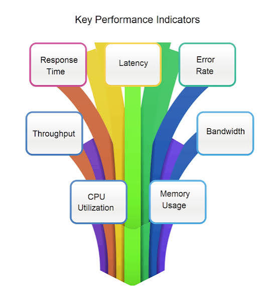
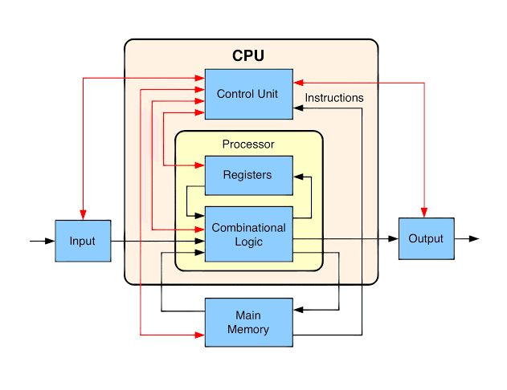
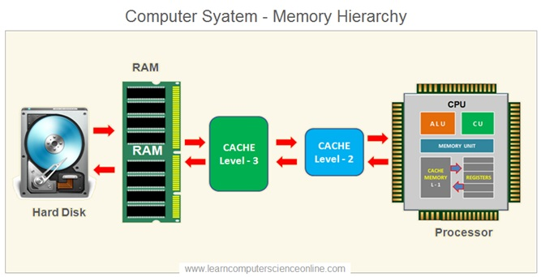
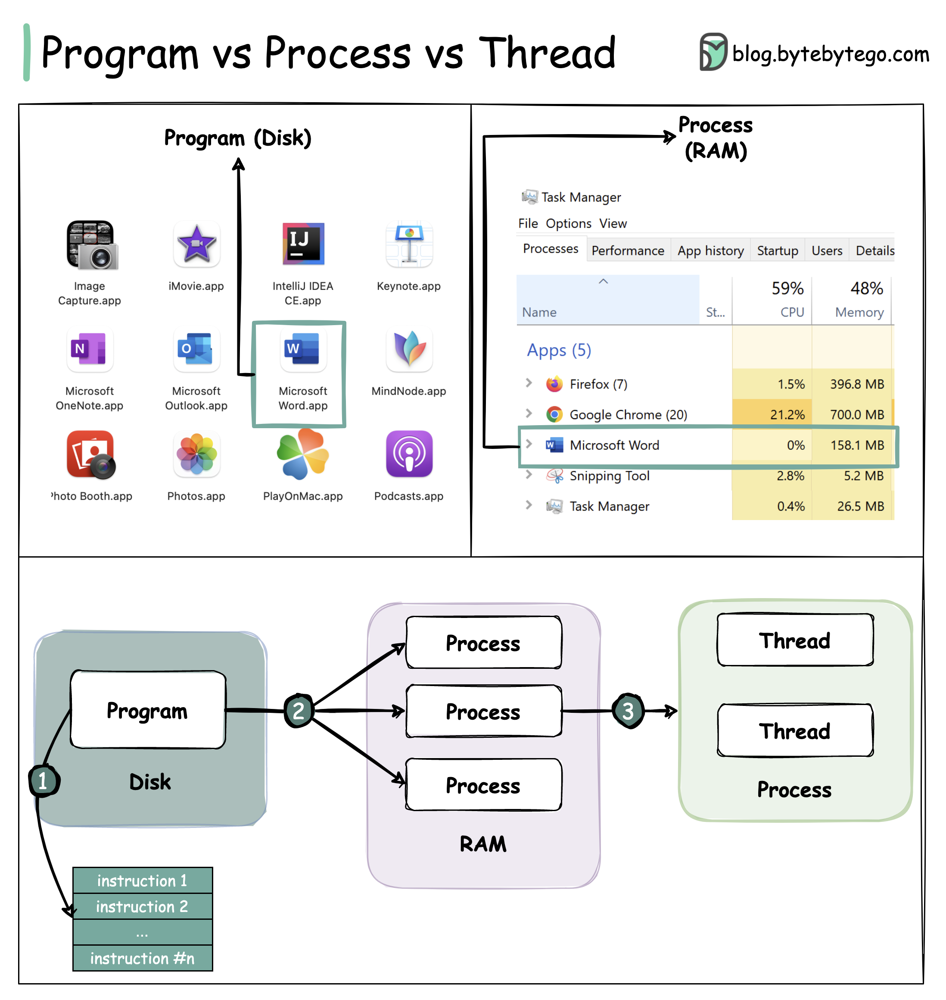
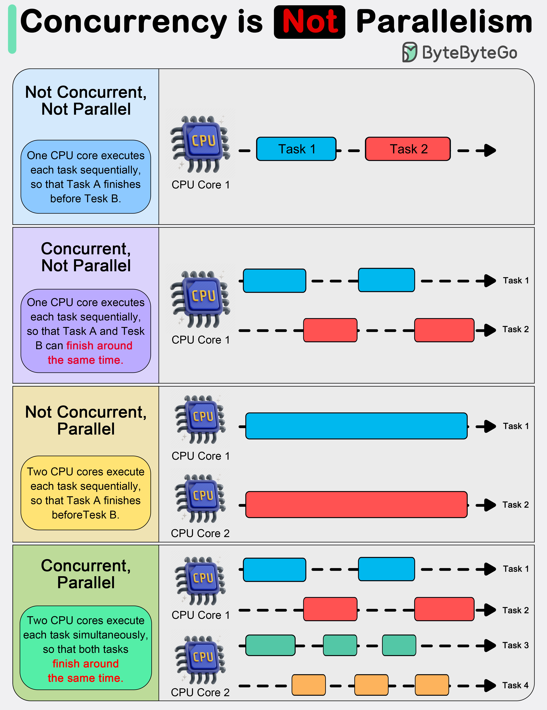
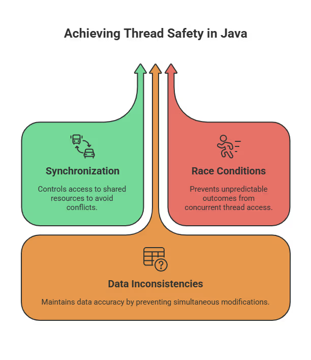
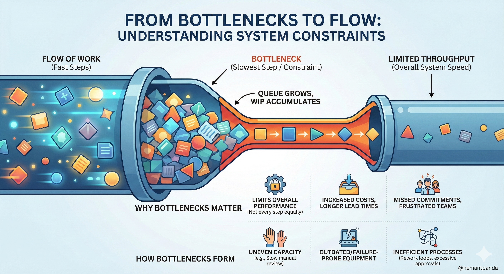

# Basic concepts of system

## 1. Performance metrics

### Performance metrics are quantifiable measurements used to track, evaluate, and assess the success or efficiency of a process.

- **Latency**: the time delay between a user's request and a system's response.
- **Throughput**: the amount of work, data, or material successfully processed by the system.
- **Bandwidth**: the theoretical maximum amount of throughput able to transfer.
- **Percentiles (p50, p90, p95, p99 / Tail Latency)**: Statistical distribution metrics used instead of simple averages.
e.g. p99 = 200ms means 99% of requests complete within 200ms, exposing long-tail performance issues.
- **Error Rate**:  The percentage of failed requests.
- **Saturation**: The degree to which system resources or queues are filled to capacity.

## Hardware & OS Resources
### CPU

- **CPU Utilization**: Percentage of CPU capacity spent on User Time, System/Kernel Time, and Idle Time.
- **I/O Wait**: Time CPU spends idling while waiting for disk or network I/O (input/output) operations to complete.
- **Load Average**: The average number of processes actively using or queued for CPU/disk over 1, 5, and 15-minute intervals. The system is saturated if the number is above 1.00 per core.

### RAM/Memory:
- **RSS (Resident Set Size)**: Physical RAM currently allocated to a process  & **VSZ (Virtual Memory Size)**: total virtual memory requested (in other words, RSS plus the idle memory).
- **OOM (Out of Memory)**: Condition where physical memory is completely exhausted, prompting the OS OOM Killer to terminate processes.
- **Memory Leak**: Unintentional failure to release allocated memory, causing memory usage to continuously rise over time.
- **Page Fault / Swapping**: The rate at which the OS reads or writes memory pages to disk when physical RAM is full. (Page Fault loads data directly from disk, Swapping swap data from disk with idle data in RAM by transfer the data in RAM to a temporary section in disk, which is retrieved later. If the program demands more RAM than total, **thrashing** is triggered, eventually leading to **OOM**).

### Disk I/O:
- **IOPS (Input/Output Operations Per Second)**: The number of read/write operations a storage drive can handle per second.
- **Read/Write Throughput**: Data transfer rate to/from storage media (e.g., MB/s).

### Network I/O: 
- The communication pipeline and data transfer between an application and remote endpoints across physical or virtual network interfaces.

## Concurrency & Execution Models

### Concurrency & Execution Models define how operating systems, language runtimes, and applications structure, schedule, and execute work across available hardware resources.

### 1. Execution Units

- **Process**: An isolated execution environment with dedicated memory space.
- **Thread**: A lightweight execution unit that runs inside a **process**, sharing memory space with other threads. Divided into **Kernel Thread** and **User-Space Threads**. 

### 2. Concurrency vs. Parallelism.

### 3. Synchronization, Overhead & Execution Pitfalls
- **Context Switching**: The CPU overhead incurred when saving and restoring state when switching execution between threads or processes.
- **Lock**: Ensures that only one thread can access a piece of data at a time.
- **Lock Contention**: When multiple threads fight for a shared lock, threads block (sleep) and context-switch into the kernel (put into system management). Parallel execution speedup is strictly bounded by the sequential (locked) portion of the application code.
- **Deadlock, Livelock & Race Conditions**: 
**Deadlock** is a circular dependency where A and B waiting for each other. **Livelock** is threads continuously change states in response to each other without making real progress. 

- **Blocking vs. Non-blocking I/O**: Operations that pause thread execution until completion vs. operations that return immediately and process results via events or callbacks.
- **Synchronous vs. Asynchronous**: Execution flow where a caller waits for a response before proceeding vs. a non-blocking caller proceeding immediately.

## Bottlenecks & System Optimization

### 1. Classification of System Bottlenecks

- **CPU-Bound**: 
    - **Symptom**: High CPU utilization, High CPU time, long run queues.
    -**Roots**: computational algorithms, serialization, garbage collection, high context-switching rates, ...
-  **Memory-Bound**: 
    - **Symptom**: High memory consumption, active swapping/page faults, high RSS, OOM.

    - **Roots**: Memory leaks, unbounded queue/buffer growth, excessive object allocations, ...
-  **Disk I/O-Bound**: 
    - **Symptom**: High `%util` on storage devices, ...

    - **Roots**: Random I/O read/write patterns, unindexed database queries, synchronous file writes without buffering/batching, ...

-  **Network I/O-Bound**: 
    - **Symptom**:High network interface bandwidth saturation, dropped packets, high TCP retransmissions, ...

    - **Roots**: Uncompressed payloads (data), high connection creation churn (open/close of network connection), cross-datacenter round-trip delays, or small socket (endpoint) buffer sizes.

-  **Lock / Contention-Bound:**: 
    - **Symptom**:Low CPU usage paired with high request latencies, frequent thread context switches, and long thread wait times.

    - **Roots**: : Coarse-grained mutexes (single lock for vast data), global state locks,...

### 2. Performance Methodologies

Two Methods is referred, with deep research into the former:
- **The USE Method** (Resource-Centric)
- **The RED Method** (Service-Centric)

### 3. Core System Optimization Strategies
- Caching Strategies (trades memory space for execution time)
- Resource Pooling (reusing initialized resources)
- Group multiple smaller operations into a single execution payload.
- OS/Kernel Tuning.

