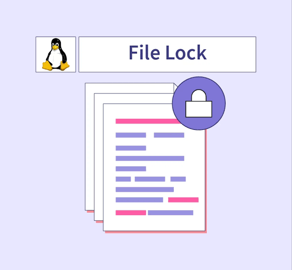

# File Locking

### 1. Advisory vs. Mandatory Locking
- **Advisory Locking**
- **Mandatory Locking**:Requires specific filesystem mount options and special file permission settings.

### 2. `fcntl()` System Call & `struct flock`
- **`fcntl()`** 
- **`struct flock` fields**:
  - `l_type`: (`F_RDLCK`, `F_WRLCK`, `F_UNLCK`).
  - `l_whence`: Starting point for offset (`SEEK_SET`, `SEEK_CUR`, `SEEK_END`).
  - `l_start`: Byte offset relative to `l_whence`.
  - `l_len`: Number of bytes to lock (`0` = to the end of the file).
  - `l_pid`: PID of the process holding a conflicting lock (populated by `F_GETLK`).

### 3. Locking Commands
- **`F_SETLK`**: Non-blocking lock attempt. Returns `-1` if conflict.
- **`F_SETLKW`**: Blocking lock attempt ("Wait").
- **`F_GETLK`**: If a lock conflict exists, overwrites `struct flock` with details about the conflicting lock (including `l_pid`). If no lock exists, sets `l_type` to `F_UNLCK`.

### 4. Read (Shared) vs. Write (Exclusive) Locks
- **Read Lock (`F_RDLCK`)**: Multiple processes can hold simultaneously.
- **Write Lock (`F_WRLCK`)**: Only a single process can hold.

### 5. Automatic Cleanup & Inheritance Rules
- **Process Boundaries**: Locks are **not inherited** across a `fork()`.
- **Automatic Release**: All locks held by a process are automatically released when the process terminates or closes **any** file descriptor referencing that file.

---

## C Code Implementations

### Demo program

```c
#include <stdio.h>
#include <stdlib.h>
#include <errno.h>
#include <fcntl.h>
#include <unistd.h>

int main(int argc, char *argv[])
{
        struct flock fl = {
            .l_type = F_WRLCK,
            .l_whence = SEEK_SET,
            .l_start = 0,
            .l_len = 0,
        };
    int fd;

    if (argc > 1) // decide read lock or write lock 
        fl.l_type = F_RDLCK;

    if ((fd = open("lockdemo.c", O_RDWR)) == -1) {
        perror("open");
        exit(1);
    }

    printf("Press <RETURN> to try to get lock: ");
    getchar();
    printf("Trying to get lock...");

    if (fcntl(fd, F_SETLKW, &fl) == -1) {
        perror("fcntl");
        exit(1);
    }

    printf("got lock\n");
    printf("Press <RETURN> to release lock: ");
    getchar();

    fl.l_type = F_UNLCK;  

    if (fcntl(fd, F_SETLK, &fl) == -1) {
        perror("fcntl");
        exit(1);
    }

    printf("Unlocked.\n");

    close(fd);

    return 0;
}
```

