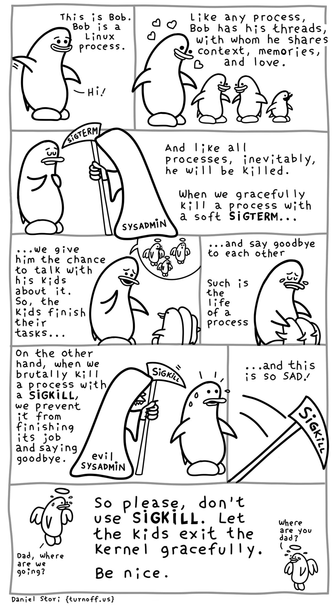

# Signals

### 1. Understanding Signals
- A **signal** is an asynchronous notification sent to a process by the kernel or another process to report an event.
- When a signal arrives, the process's normal execution is interrupted immediately, and control transfers to a designated **signal handler function**.
- After the handler finishes executing, the program resumes where it was interrupted unless instructed to terminate.

### 2. Catching Signals with `sigaction()`
- **`sigaction()`** is used to install signal handlers reliably.
- The `struct sigaction` contains:
  - `sa_handler`: Pointer to the handler function, `SIG_IGN` (ignore signal), or `SIG_DFL` (default behavior).
  - `sa_mask`: A set of signals blocked while the handler is executing, initialized using `sigemptyset()`.
  - `sa_flags`: Flags modifying handler behavior (e.g., `SA_RESTART` to automatically restart interrupted system calls).
- **`signal()` vs `sigaction()`**: The traditional ANSI C `signal()` function is less reliable.

### 3. Key Standard Signals
- **`SIGINT`**: Terminal interrupt (triggered by `CTRL-C`); default action terminates the process.
- **`SIGKILL` & `SIGSTOP`**: Uncatchable and unignorable signals used to forcibly terminate or stop execution.
- **`SIGTERM`**: Default termination signal sent by the command-line `kill pid` utility.
- **`SIGUSR1` & `SIGUSR2`**: User-defined signals reserved for custom application logic.

### 4. Reentrancy & Asynchronous Signal Safety
- **Reentrancy Hazards**: Since signals interrupt code asynchronously, calling non-reentrant functions (functions using static or global state, like `strtok()`) inside a handler can corrupt state.
- **Async-Signal-Safe Functions**: Only a specific subset of system calls and functions can safely be invoked inside a signal handler (e.g., `write()` is safe, whereas `printf()` is not).

### 5. Managing Shared Global State
- To safely share data between a signal handler and the rest of the application, variables must be declared as **`volatile sig_atomic_t`**.
- A common design pattern is for the signal handler to simply set a `volatile //force store in main memory sig_atomic_t //do not split the variable` flag and return, allowing the main program loop to handle the event cleanly without race conditions.

---

## C Code Implementations

### Example 1: Catching `SIGINT` (`CTRL-C`) with `sigaction()`

```c
#include <stdio.h>
#include <stdlib.h>
#include <unistd.h>
#include <errno.h>
#include <signal.h>

void sigint_handler(int sig)
{
    (void)sig; // Suppress unused parameter warning
    const char msg[] = "Ahhh! SIGINT!\n";
    /* write() is used instead of printf() because it is async-signal-safe */
    write(1, msg, sizeof(msg) - 1);
}

int main(void)
{
    char s;
    struct sigaction sa = {
        .sa_handler = sigint_handler,
        .sa_flags = SA_RESTART /* Restart interrupted system calls like fgets */
    };
    sigemptyset(&sa.sa_mask);

    if (sigaction(SIGINT, &sa, NULL) == -1) {
        perror("sigaction");
        exit(1);
    }

    printf("Enter a string (try hitting ^C):\n");
    if (fgets(s, sizeof(s), stdin) == NULL)
        perror("fgets");
    else
        printf("You entered: %s\n", s);

    return 0;
}
```
```c
#include <stdio.h>
#include <stdlib.h>
#include <unistd.h>
#include <errno.h>
#include <signal.h>

/* Atomic flag safely modified inside signal handler */
volatile sig_atomic_t got_usr1 = 0;

void sigusr1_handler(int sig)
{
    (void)sig;
    got_usr1 = 1;
}

int main(void)
{
    struct sigaction sa = {
        .sa_handler = sigusr1_handler,
        .sa_flags = 0
    };
    sigemptyset(&sa.sa_mask);

    if (sigaction(SIGUSR1, &sa, NULL) == -1) {
        perror("sigaction");
        exit(1);
    }

    while (!got_usr1) {
        printf("PID %d: working hard... (send 'kill -USR1 %d')\n", getpid(), getpid());
        sleep(1); /* Interrupted immediately when signal arrives */
    }

    printf("Done in by SIGUSR1!\n");
    return 0;
}

```


### 6. Signal Queueing & Edge Cases
- **Default Deferral**: When a signal handler is actively executing, arrival of the same signal is deferred by default until the handler finishes.
- **Signal Collapsing (No Counting)**: If a signal is raised multiple times while blocked or deferred, those signals are collapsed into a single pending signal. When unblocked, the signal handler is invoked **only once**.

### 2. Blocking Signals with `sigprocmask()`
- **`sigprocmask()`** modifies the process-wide mask of blocked signals. Blocked signals are not discarded; they are held pending and delivered immediately once unblocked.
- **`how` Parameter Options**:
  - `SIG_BLOCK`: Adds the specified set of signals to the current blocked set.
  - `SIG_UNBLOCK`: Removes the specified signals from the blocked set.
  - `SIG_SETMASK`: Overwrites the current blocked mask with the new signal set.

### 3. Signal Handler Best Practices
- **Minimal Handlers**: Signal handlers should perform minimal work.

### 4. The Self-Pipe Trick (`poll()` / `select()`)
- Integrates signal handling directly into file-descriptor-based I/O multiplexing event loops (`poll()` or `select()`).
- **Mechanism**:
  1. A pipe (`pipefd[2]`) is created.
  2. The read end (`pipefd[0]`) is registered with `poll()` or `select()`.
  3. Inside the signal handler, writing a single byte to the write end (`pipefd[1]`) wakes up `poll()` / `select()`.
  4. The main event loop reads the byte from the pipe and handles the signal event cleanly in user space.

### 5. Atomic Unmasking with `pselect()`
- **`pselect()`** extends `select()` by accepting a signal mask parameter (`sigmask`).
- It **atomically** swaps the process signal mask to `sigmask` while waiting for I/O or signals, then restores the original signal mask upon returning.
- This prevents race conditions where a signal arrives in the window between checking a flag and entering a sleeping state.

---

## C Code Implementations

### Example 1: Blocking and Unblocking Signals (`sigblock.c`)

```c
#include <stdio.h>
#include <unistd.h>
#include <signal.h>

int main(void)
{
    sigset_t mask, oldmask;

    // Create a signal set containing SIGINT (CTRL-C)
    sigemptyset(&mask);
    sigaddset(&mask, SIGINT);

    // Block SIGINT and save previous mask in oldmask
    sigprocmask(SIG_BLOCK, &mask, &oldmask);

    puts("Try to ^C out of here! You can't for 5 seconds!");
    sleep(5);

    puts("Ok, now unblocking SIGINT...");
    // Restore original mask (unblocking SIGINT)
    sigprocmask(SIG_SETMASK, &oldmask, NULL);

    puts("If you hit ^C during sleep, this line won't print because default handler exits!");

    return 0;
}
```
### Example 2: The Self-Pipe Pattern with poll() (pipesig.c)
```c
#include <stdio.h>
#include <stdlib.h>
#include <string.h>
#include <unistd.h>
#include <signal.h>
#include <poll.h>

static int pipefd[2];

void handler(int sig)
{
    (void)sig;
    // Write a single byte to notify main loop (write is async-signal-safe)
    write(pipefd[1], "1", 1);
}

int main(void)
{
    char line[256];
    struct sigaction sa = {
        .sa_handler = handler,
        .sa_flags = SA_RESTART
    };
    sigemptyset(&sa.sa_mask);

    if (pipe(pipefd) == -1) {
        perror("pipe");
        exit(1);
    }

    if (sigaction(SIGUSR1, &sa, NULL) == -1) {
        perror("sigaction");
        exit(1);
    }

    struct pollfd pollfds[2] = {
        { .fd = 0, .events = POLLIN },          // stdin
        { .fd = pipefd[0], .events = POLLIN }   // pipe read end
    };

    printf("PID %d: Waiting for stdin or SIGUSR1 (try 'kill -USR1 %d')...\n", getpid(), getpid());

    for (;;) {
        int st = poll(pollfds, 2, -1);
        if (st == -1) {
            perror("poll");
            break;
        }

        // Handle user keyboard input
        if (pollfds[0].revents & POLLIN) {
            if (fgets(line, sizeof(line), stdin) == NULL)
                break;
            line[strcspn(line, "\n")] = '\0';
            if (strcmp(line, "quit") == 0)
                break;
            printf("You entered: \"%s\"\n", line);
        }

        // Handle signal notification via pipe
        if (pollfds[1].revents & POLLIN) {
            char sigdata[1024];
            int count = read(pipefd[0], sigdata, sizeof(sigdata));
            for (int i = 0; i < count; i++) {
                if (sigdata[i] == '1')
                    printf("Signal event: SIGUSR1 occurred!\n");
            }
        }
    }

    return 0;
}
```

### Example 3: Synchronizing Signals with pselect() (pselect.c)
```c
#include <stdio.h>
#include <stdlib.h>
#include <string.h>
#include <unistd.h>
#include <errno.h>
#include <signal.h>
#include <sys/select.h>

static volatile sig_atomic_t sigusr1_happened = 0;

void handler(int sig)
{
    (void)sig;
    sigusr1_happened = 1;
}

int main(void)
{
    char line[256];
    sigset_t mask, oldmask;
    fd_set readfds;

    struct sigaction sa = {
        .sa_handler = handler,
        .sa_flags = 0
    };
    sigemptyset(&sa.sa_mask);

    if (sigaction(SIGUSR1, &sa, NULL) == -1) {
        perror("sigaction");
        exit(1);
    }

    // Block SIGUSR1 in normal execution
    sigemptyset(&mask);
    sigaddset(&mask, SIGUSR1);
    sigprocmask(SIG_BLOCK, &mask, &oldmask);

    printf("PID %d: Ready. Send SIGUSR1 with 'kill -USR1 %d'\n", getpid(), getpid());

    for (;;) {
        FD_ZERO(&readfds);
        FD_SET(0, &readfds); // stdin

        // pselect atomically unblocks SIGUSR1 (using oldmask) while sleeping
        int st = pselect(1, &readfds, NULL, NULL, NULL, &oldmask);

        if (st == -1 && errno == EINTR) {
            if (sigusr1_happened) {
                sigusr1_happened = 0;
                printf("pselect caught SIGUSR1!\n");
            }
        } else if (st > 0 && FD_ISSET(0, &readfds)) {
            if (fgets(line, sizeof(line), stdin) == NULL)
                break;
            line[strcspn(line, "\n")] = '\0';
            if (strcmp(line, "quit") == 0)
                break;
            printf("You entered: \"%s\"\n", line);
        }
    }

    return 0;
}
