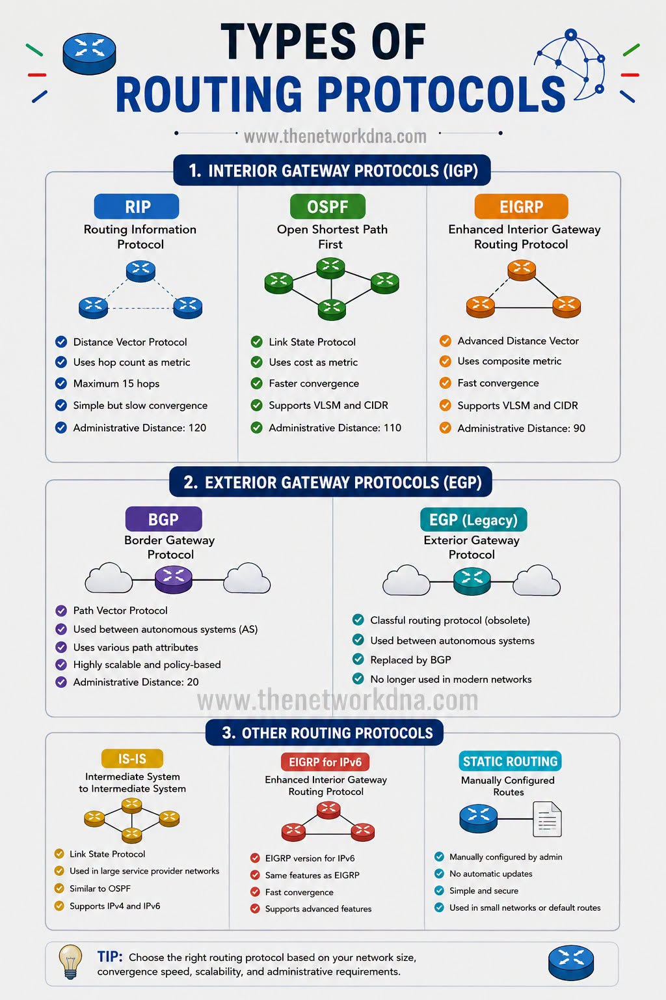
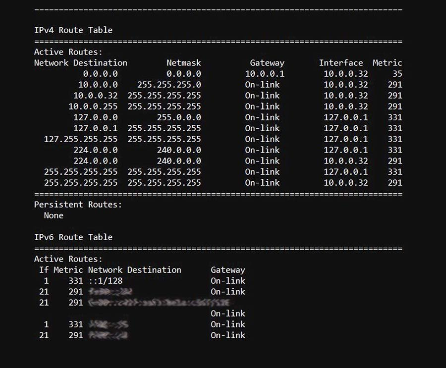
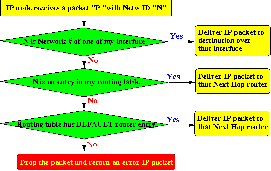

# Section 18: IP Routing
## 1. Routing Protocols: IGP vs. EGP

* **Goal of Routing Protocols:** Learn the network map.
* **Interior Gateway Protocols (IGP):** Routing within an AS.
  * *Examples:* **OSPF** (Open Shortest Path First — most common), **IS-IS**, **EIGRP**, ...
* **Exterior Gateway Protocols (EGP):** Used for routing between different ASs.
  * *Standard Protocol:* **BGP** (Border Gateway Protocol).

---

## 2. Routing Tables & Default Gateway

* **Routing Table Structure:** Maps destination IP subnets to specific output network interfaces or next-hop router IP addresses.
* **Special Interfaces & Routes:**
  * **Loopback (`lo` / `127.0.0.1`):**  self-communication.
  * **Direct LAN Subnets:** physical link-layer interfaces (e.g., `wlan0` or `eth0`).
  * **Default Gateway:** The "router of last resort".

---

## 3. The IP Routing Algorithm

When a packet arrives, the router follows a strict decision sequence:
1. **Local Network Check**.
2. **Specific Route Match:** Routing table has an entry for the destination.
3. **Default Route Match:** Forward to default gateway router if exists.
4. **Drop & Error:** Drop the packet,send an **ICMP** error message back to the sender.
* **Tie-Breaking Rules:** Longest subnet mask -> lowest metric/cost ->  **ECMP** (Equal-Cost Multi-Path).

---

## 4. Routing Loops & Time-To-Live (TTL)
* **Loop Prevention:** 1-byte **Time-To-Live (TTL)** field.
* **Decrementing TTL:** When TTL reaches 0, the packet is dropped -> **ICMP "Time Exceeded"**.
* **Traceroute Utility:** Works by sending packets with incrementally increasing TTL values (`1`, `2`, `3`, ...).

---

## 5. Broadcast Addresses
* **Subnet Broadcast:** An address where all host bits are set to `1` (e.g., `192.168.1.255` for `/24`), sending packets to every host on that specific LAN.
* **Limited Broadcast (`255.255.255.255`):** Used by hosts when they do not know their own network details yet (initial DHCP requests).
* **Router Boundary:** Routers **never** forward broadcast packets beyond the local LAN.