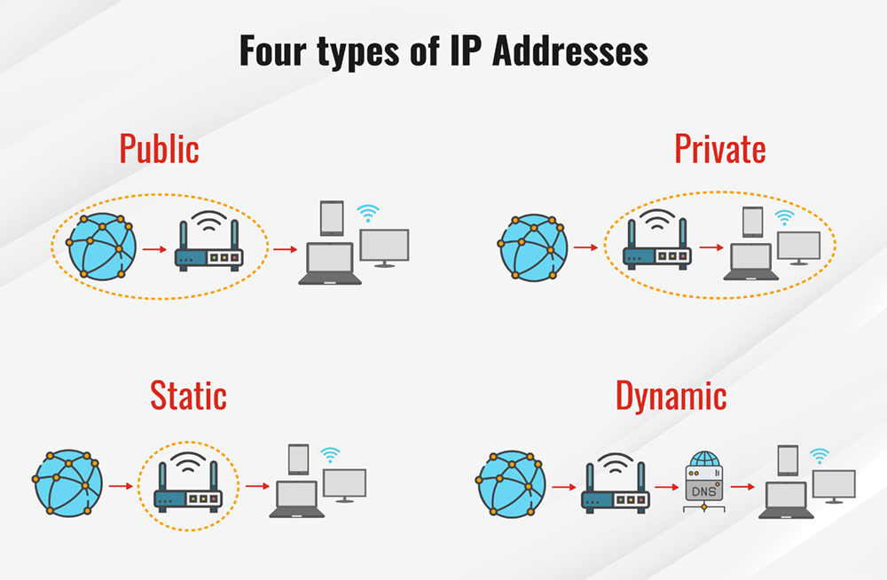

# Section 6: The Internet Protocol (IP)

## 1. Overview & Core Purpose
* **Role of IP:** The Internet Protocol (IP) routes data packets across the Internet, like a post office routes physical mail.
* **IP Address:** Every packet must be labeled with a source and destination IP address that uniquely identifies a computer (**host**) on the network [2].

---

## 2. IP Versions
* **IPv4 (Plain "IP")**.
* **IPv6:** Uses **16 bytes**.

---

## 3. Subnets & Address Structure
Every IP address is divided into two parts:
  1. **Network Portion (Initial bits):** Identifies the specific network/subnet.
  2. **Host Portion (Trailing bits):** Identifies the specific computer within that subnet.
* **Reserved Addresses:** Host addresses with all-zero or all-one bits are reserved.

---

## 4. Companion IP-Layer Protocols
* **ICMP (Internet Control Message Protocol):** Used by IP nodes to exchange control metadata.
  * `ping` uses ICMP **echo request** and **echo response** messages.
  * `traceroute` uses ICMP **time exceeded** messages to trace path routing.
* **IPSec (Internet Protocol Security):** Provides encryption and authentication at the IP layer, frequently used in VPNs.

---

## 5. Network Types & IP Allocation
* **Private Networks & NAT:** Private networks use IP addresses that are unique only within the LAN; **NAT (Network Address Translation)** allows them to communicate externally without needing globally unique IPs .
* **Static vs. Dynamic IP Addresses:**
  * **Static IP:** Permanently assigned and unchanging, necessary for public servers or SSH endpoints so users can reliably locate them.
  * **Dynamic IP:** Temporarily allocated on-demand by an ISP or local network.
* **DHCP (Dynamic Host Configuration Protocol):** A server protocol on the LAN that automatically assigns dynamic IP addresses, subnet masks, and network configurations to connecting hosts.