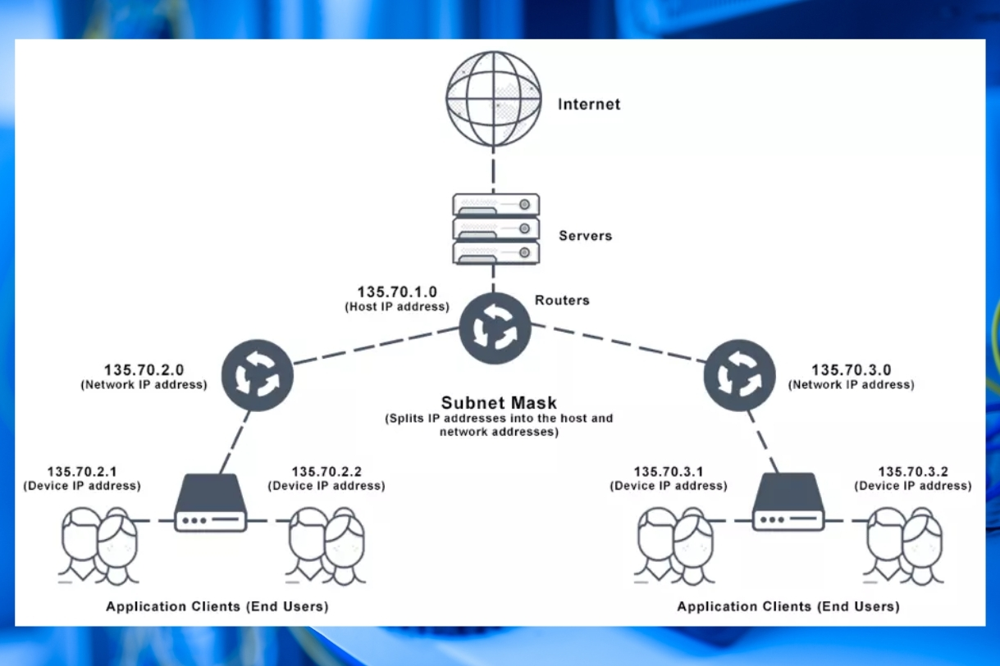

# Section 17: IP Subnets and Subnet Masks

## 1. 32-Bit Integer Address Representation
* **32-Bit Packing:** Packing all four bytes into a single 32-bit numeric integer allows computers and routers to perform bitwise calculations in a single operation.

---

## 2. Converting Between Formats
* **Dots-and-Numbers to 32-Bit Value:**
  1. Split IP into four separate byte integers.
  2. Shift each byte into its proper bit position and combine them.
* **32-Bit Value back to Dots-and-Numbers:**
  1. Extract each byte by right-shifting (`>>`) by 24, 16, 8, or 0 bits, and masking with `& 0xff` (`255`) to zero out upper bits.

---

## 3. Subnets & Slash Notation (CIDR)

* **Address Division:** Every IP address is split into two parts:  **subnet (network)** portion and **host** portion.
* **Slash Notation:** Specifies how many bits from the left represent the network portion (e.g., `/17` means 17 network bits and (32 - 17 = 15) host bits).
* Note that all bits are represented in binary.
---

## 4. Subnet Masks & Bitwise Extraction
* **Subnet Mask Definition:** A 32-bit number holding `1` bits for the network portion and `0` bits for the host portion.
* **Extracting Network Address:** Subnet can be determined by performing `&` between the IP address and subnet mask.
* **Extracting Host Portion:** Performing a bitwise-NOT (`~`) on the subnet mask and continue.