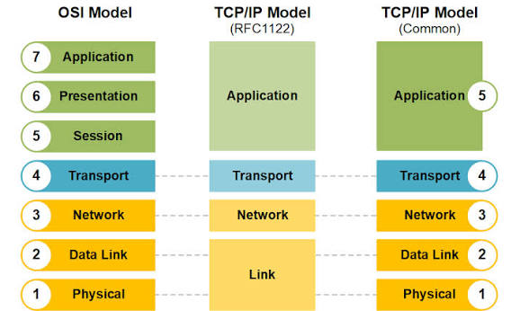

# Section 4: The Layered Network Model

## 4.1 Key Terminology
* **IP Address**: Uniquely identifies a host on the network. 
  * **IPv4**: 4 bytes, written in dots-and-numbers notation.
  * **IPv6**: 16 bytes, written in hexadecimal notation (e.g., `2001:db8::8a2e:370:7334`) [5].
* **Port Number**: Identifies a specific process (0–65535).
* **TCP (Stream Sockets)**.
* **UDP (Datagram Sockets)**:.
* **Router**: A specialized computer that forwards packets across networks by IP.
* **MAC Address**: Physical address unique to device.
* **Header**: Metadata prepended to a data payload at each protocol layer.

---

## 4.2 Protocol Layering Example (Encapsulation & Decapsulation)

1. **Application Layer**: Builds raw application data (`HTTP request`) [10].
2. **Transport Layer**: OS wraps the HTTP data in a **TCP header** containing source and destination port numbers [12].
3. **Internet Layer**: OS wraps the TCP-HTTP payload in an **IP header** containing source and destination IP addresses [12].
4. **Link Layer**: OS looks up the destination MAC address (via the ARP cache) and wraps the packet in an **Ethernet header** [13, 14].

**Data Encapsulation Sequence**:  
`[ Ethernet Header | IP Header | TCP Header | HTTP Data Payload ]`

## 4.3 The Internet Layer Model (4-Layer Model)
The Internet architecture divides networking tasks into 4 practical layers [16, 17]:

| Layer | Primary Responsibility | Example Protocols |
| :--- | :--- | :--- |
| **Application** | Structured application data and protocols | HTTP, FTP, SSH, SMTP [16, 17] |
| **Transport** | End-to-end data integrity, packet splitting & reassembly | TCP, UDP [17] |
| **Internet** | Packet routing across host addresses | IP (IPv4, IPv6), ICMP [17] |
| **Link** | Local network delivery and physical signal transmission | Ethernet, Wi-Fi, PPP [17] |

---

## 4.4 The ISO OSI 7-Layer Model
 