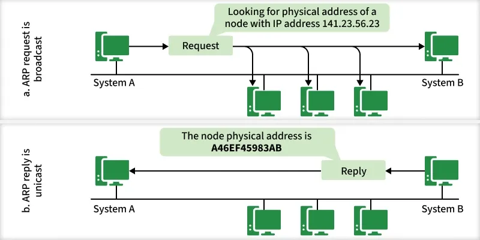
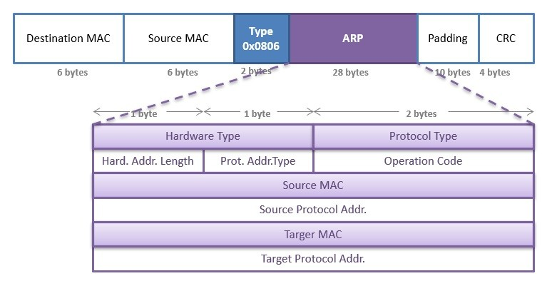

# Section 21: ARP: The Address Resolution Protocol

## 1. The Core Problem ARP Solves
* **Missing Destination MAC**.
* **Layer Bridging:** ARP maps a known Network Layer (IPv4) address to an unknown Link Layer (Ethernet MAC) address for devices on the same local physical network.

---

## 2. Request & Response Mechanism

* **Ethernet Broadcast Frame:** **ARP request**: "Who has this IP address?".
* **EtherType Identifier** differentiate it.
* **Unicast Reply:** Only the machine assigned that IP responds. It constructs a unicast **ARP reply** containing its MAC address and sends back.

---

## 3. ARP Caching
* **Temporary Local Table:** The OS caches IP-to-MAC mappings in an **ARP cache**.
* **Cache automaticaly expire**.

---

## 4. ARP Packet Payload Structure (28 Octets)

* **Hardware Type (2 octets):** Specifies the Link Layer protocol (`0x0001` for Ethernet).
* **Protocol Type (2 octets):** Specifies the Network Layer protocol (`0x0800` for IPv4).
* **Address Lengths (1 octet each):** `6` for MAC address length, `4` for IPv4 address length.
* **Operation / Opcode (2 octets):** `0x0001` for an ARP Request, `0x0002` for an ARP Reply .
* **Address Fields:** Contains Sender MAC (6 octets), Sender IP (4 octets), Target MAC (6 octets, zeroed in requests), and Target IP (4 octets).

---

## 5. Advanced Features & IPv6
* **ARP Announcements:** First joint broadcast globally.
* **ARP Probe:** An ARP request for checking IP duplicate.
* **IPv6 Neighbor Discovery Protocol (NDP):** IPv6 uses **NDP** built on top of ICMPv6 instead.