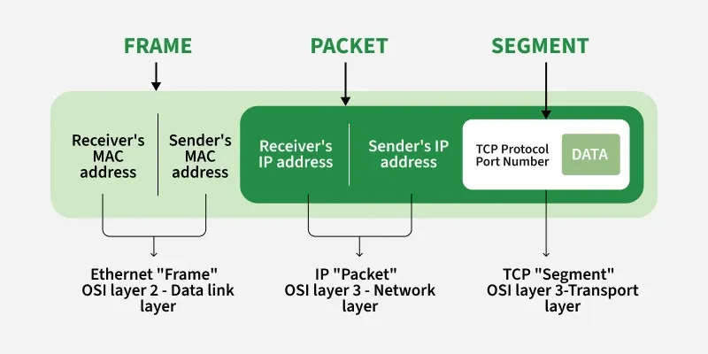
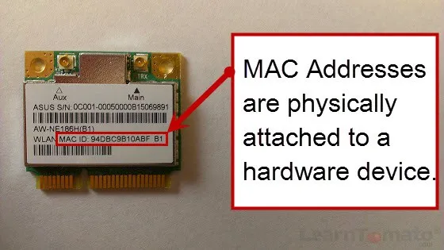
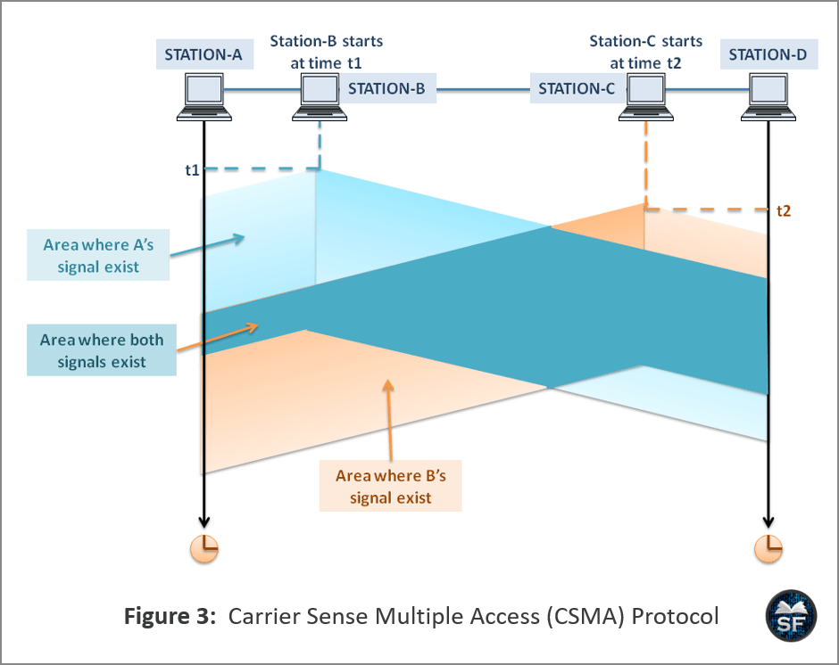
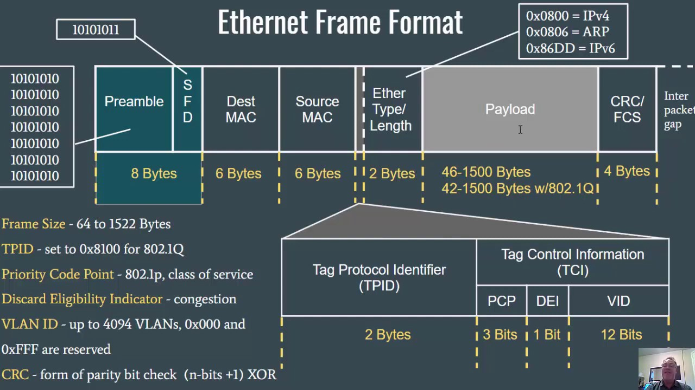

# Section 20: The Link Layer and Ethernet
## 1. Terminology

* **Octet:** A sequence of exactly 8 bits (a "byte" was not strictly 8 bits).
* **Frames vs. Packets:** A link-layer transmission on the wire: **Ethernet packet**; contains **Ethernet frame** inside.

---

## 2. MAC Addresses

* **Format & Uniqueness:** 6-octet,`ac:d1:b8:df:20:85`, must be unique on a LAN.
* **OUI (Organizationally Unique Identifier):** The first 3 octets identify the hardware manufacturer.

---

## 3. Shared Medium & Network Hardware
* **Shared Medium Analogy:** Computers on a LAN communicate like people in a room shouting names; devices inspect frames addressed to their MAC address.
* **Hubs vs. Switches:** Hubs blindly broadcast frames.Switches inspect destination MAC addresses and forward traffic only to that.

---

## 4. Channel Access Methods (Multiple Access)

* **CSMA/CD (Collision Detection — Wired Ethernet):**
  Sends a **jam signal** to notify others, waits a random backoff time, and retries.
* **CSMA/CA (Collision Avoidance — Wireless Wi-Fi):**
  Waits a random backoff time *before* attempting transmission to prevent collisions.

---

## 5. Ethernet Packet & Frame Structure

* **Ethernet Packet Fields:**
  * **Preamble (7 octets):** `AA AA AA AA AA AA AA` for clock synchronization.
  * **Start Frame Delimiter / SFD (1 octet):** `AB` marking the start of the frame.
* **Ethernet Frame Fields:**
  * **Destination & Source MAC Addresses (6 octets each)** .
  * **Dot1q Tag (4 octets, optional):** For VLAN identification [16].
  * **Payload Length / EtherType (2 octets):** Values ≤ 1500 represent payload length; values > 1500 specify payload protocol (e.g., `0x0800` for IPv4, `0x0806` for ARP).
  * **Payload (46–1500 octets):** Standard MTU (Maximum Transmission Unit) is 1500 octets.
  * **CRC-32 Checksum (4 octets):** Used for link-layer error detection.

---

## 6. Two Layers of Ethernet (Internet vs. OSI Model)
* **Internet Model:** Combines framing and physical signalling into a single **Link Layer**.
* **OSI 7-Layer Model:**
  1. **Data Link Layer:** Logical framing, MAC addresses, and CRC checksums.
  2. **Physical Layer:** Bitstream signaling, preambles, carrier sense, and interpacket gaps.