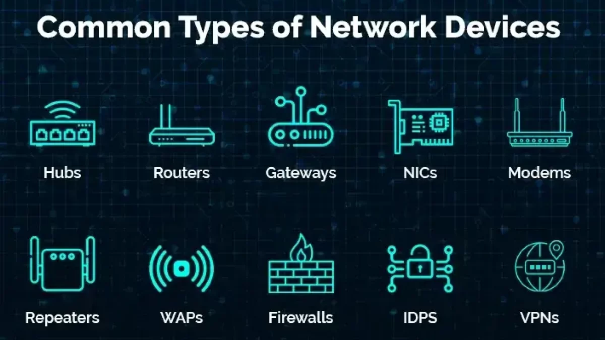
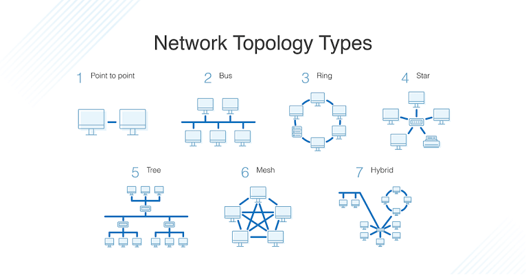
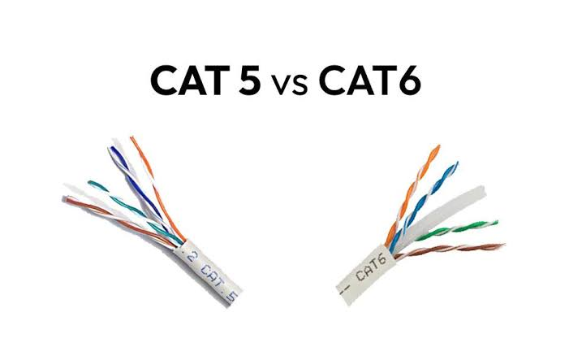
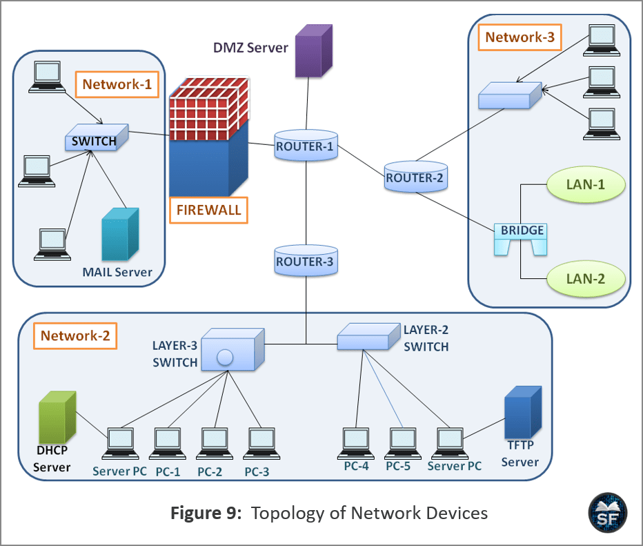
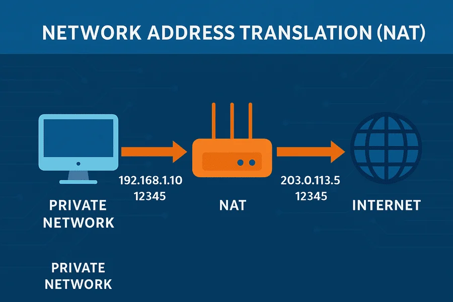

# Section 24: Network Hardware

## 1. Network Metrics

* **Network Topology:** Network graph and how data flows across nodes.
* **Bandwidth & Speeds:** Measured in bits per second (Mbs/Gbs). Connections are often asymmetric.
* **LAN vs. WAN:** A **LAN** is a single local network/subnet (e.g., home network).A **WAN** connects multiple LANs.

---

## 2. Cables, Standards & Interfaces

* **Physical Cabling:** Uses twisted-pair copper cables categorized by standards (e.g., **Cat-5** for Fast Ethernet, **Cat-6** for Gigabit Ethernet, **10GbaseT** for 10-Gigabit Ethernet) or fiber optics using light over glass.
* **Network Ports vs. Software Ports:** Physical sockets where cables plug in are called **network ports**.
* **NIC vs. OS Network Device:**
  * **NIC (Network Interface Card):** The physical hardware expansion card or motherboard chip handling network signals.
  * **OS Device:** Virtual, belongs to software simulations.

---

## 3. LAN Hardware: Hubs vs. Switches vs. Bridges

* **Hub:** Put all connected devices in the same wire (conversation).
* **Switch:** A smart hub that transfer data only between sender and receiver.
* **Bridge:** A device connecting two separate networks at the Link Layer, allowing them to function as a single unified network.

---

## 4. Edge Hardware: Routers, Gateways & Security

* **Router:** A Network Layer device with multiple network interfaces that uses routing tables to forward packets (Distributer).
* **Default Gateway:** Handle destination outside the local subnet.
* **Modem:** converts Ethernet LAN signals into DSL, light, ...
* **Firewall & NAT:** Devices (often integrated into routers) that inspect traffic to block unauthorized access (Firewall) or translate private local IP addresses into a public IP address (NAT).