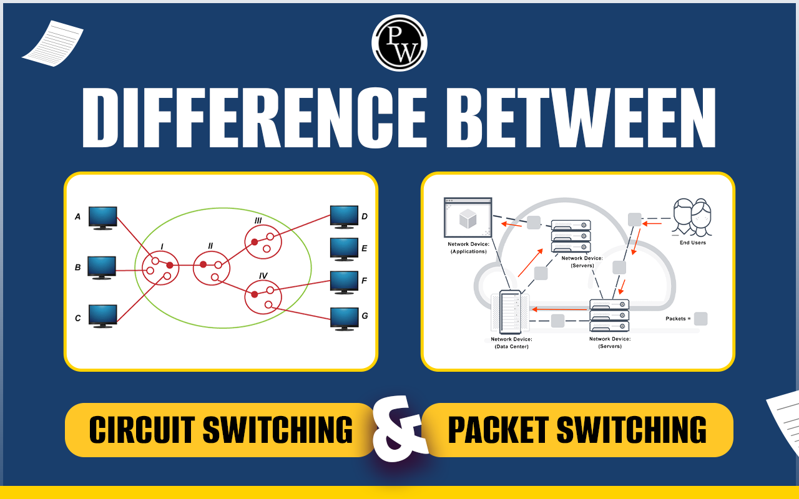
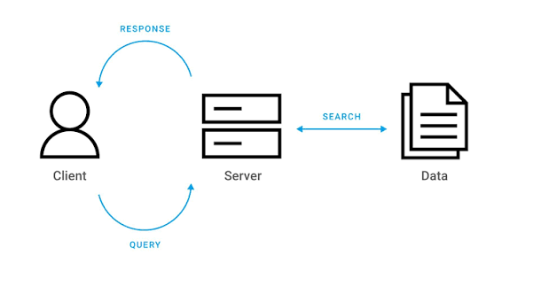
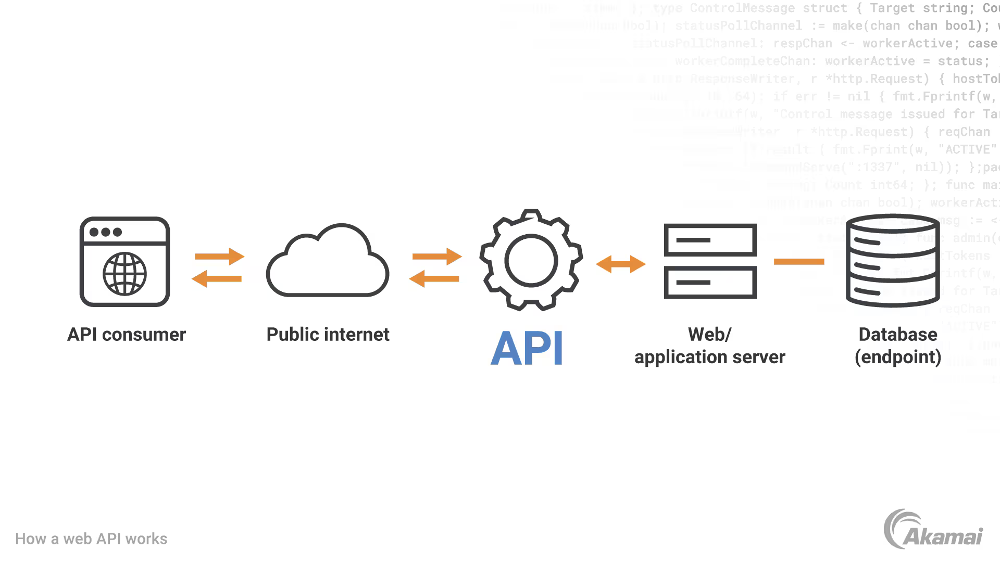
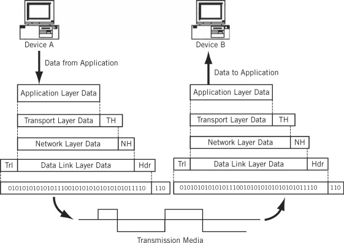

# Section 2: Networking Overview - Summary & Notes

## 1. Core Networking Concepts

### 1.1 Fundamentals of Network Communication
- Goal: exchange arbitrary bytes of data between computers over a LAN/Internet.
 - This requires mechanisms for identification, routing, data integrity, and supporting things involved.

### 1.2 Circuit-Switched vs. Packet-Switched Networks

 **Circuit-Switched Networks**: Dedicated physical connection. Inefficient line utilization, no multiplexing, physical scaling limits.
* **Packet-Switched Networks**: Divide data into discrete packets. Multiple devices can send interleaved packets across shared wires simultaneously.

---

## 2. Architecture & Abstraction

### 2.1 Client/Server Architecture

* **Server**: Sits idle waiting for incoming connections and process them.
* **Client**: Actively initiates a connection to a server to request data or services.

### 2.2 The OS & Sockets API

- OS controls the hardware.
- Applications communicate over the network through system calls provided by the **sockets API** (the bridge between Dev and Data).

### 2.3 Protocols & Protocol Stacks

A **protocol** defines the strict formatting, sequence, and rules governing data exchange between devices
* Common protocols: **TCP** (reliable transport), **UDP** (lightweight transport), **IP** (routing across networks), **HTTP** (web requests), and **Ethernet** (LAN delivery).
* Data is passed down through a **protocol stack**, where each layer prepends its own header to the payload (**Data Encapsulation**).

### 2.4 Wired vs. Wireless (WiFi)
Wired (Ethernet cables) and wireless networks (WiFi) operate on the same LAN using Ethernet protocol. The distinction lies in the physical medium..

---

## 3. Reflection Answers

1. **Is the Internet circuit-switched or packet-switched?**
   The Internet is a **packet-switched network**, breaking data into discrete packets transmitted over shared lines.

2. **What is the relationship between a client program and a server program?**
   A server waits for connections and responds to requests, while a client actively connects to the server to request services.

3. **What role does the OS play when you’re writing networked programs?**
   The OS controls all network hardware access and provides the **sockets API** through which application code executes network communications.

4. **What is a protocol?**
   A protocol is a strictly defined set of rules specifying the byte format, ordering, and timing of data exchanged between endpoints.

5. **What are the reasons for having a protocol stack and data encapsulation?**
   It enforces modularity and separation of concerns. Each layer handles a distinct responsibility (e.g., routing, data integrity, physical delivery) without needing to know the details of other layers.

6. **What are the practical differences between a WiFi network and a wired network?**
   Both use Ethernet protocol rules on a LAN, but wired networks send electrical signals over cables while WiFi transmits radio waves over the air.