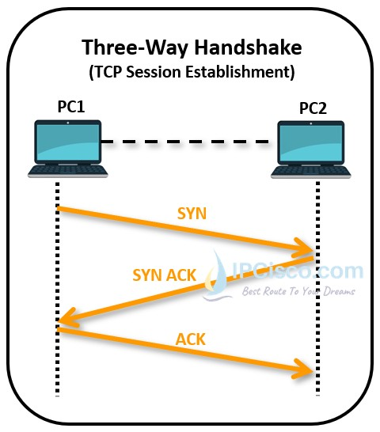

# Section 14: Transmission Control Protocol (TCP)

## 1. Core Purpose & Goals
* **Reliable Connection:** TCP ensure data is transferred reliably.
* **Key Goals:** Provides reliable data transfer, flow control, congestion control, and support for out-of-band data.

---

## 2. Location in Network Stack & Ports
* **Transport Layer:** Above IP, below HTTP.
* **TCP Ports:** Uses 16-bit port numbers (0–65535) to direct incoming data to the correct process running on a host.

---

## 3. Connection Lifecycle
* **1. Making the Connection (Three-Way Handshake):**
  1. Client sends a `SYN` (synchronize) packet.
  2. Server responds with a `SYN-ACK` (synchronize-acknowledge) packet.
  3. Client replies with an `ACK` (acknowledge) packet.
  * Initial sequence numbers are set to random values during this setup phase.
* **2. Transmitting Data:**
  * Data streams are split into chunks wrapped in TCP headers, known as **TCP segments**.
  * Every transmitted segment requires an `ACK` from the receiver; if an `ACK` is not received before a timeout, the segment is resent.
* **3. Closing the Connection:**
  * Cleanly closed using `FIN` and `ACK` packets exchanged between both ends [8, 9].
  * Closing a socket while unread data remains triggers a `RST` (reset) packet, showing as "Connection reset by peer".

---

## 4. Data Integrity & Error Detection
* **Packet Ordering:** The receiver uses sequence numbers to reorder segments that arrive out of order.
* **Checksum Verification:**
  * A 16-bit checksum is calculated over the TCP header, payload, and an IP pseudo-header prior to sending.
  * The receiver recomputes the checksum; if it differs from the header value, the segment is discarded and retransmitted upon timeout.

---

## 5. Flow Control vs. Congestion Control
* **Flow Control (Receiver Protection):**
  * Prevents a fast sender from overwhelming a slow receiver.
  * Implemented using a **sliding window**: The receiver advertises its available buffer space (in bytes) inside the `window` field of `ACK` packets.
* **Congestion Control (Network Protection):**
  * Prevents senders from overloading intermediate routers across the Internet.
  * **Slow Start:** Begins with a small congestion window that grows exponentially as `ACK`s return, until packet loss occurs .
  * **Congestion Avoidance:** Switches to linear growth once packet loss occurs, cautiously probing network capacity until another loss.