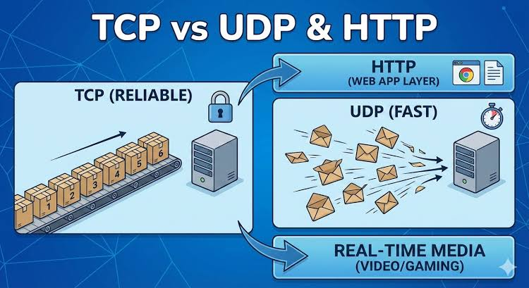

# Section 15: User Datagram Protocol (UDP)

## 1. Goals & Characteristics of UDP
* **Single Guarantee:** If data arrives, it is guaranteed to be uncorrupted.
* **What UDP Does NOT Provide:** No guarantees for packet ordering, loss prevention, or duplicate suppression .
* **High Efficiency:** Lacks connection handshakes, ACKs, or flow control.

---

## 2. Location in Network Stack & Ports
* **Transport Layer:** Same level as TCP.
* **UDP Ports:** Uses 16-bit port numbers (0–65535) to deliver datagrams to specific processes on a host. TCP and UDP port spaces are distinct, allowing a TCP and a UDP service to share the same port number.

---

## 3. Connectionless Datagram Model
* **No Connection State:** UDP operates on an individual packet basis without handshakes or persistent connection setup.
* **Addressing Per Packet:** Every datagram is routed independently using target IP and port addresses. Receiving calls extract the sender's address tuple to allow direct replies.

---

## 4. Data Integrity & Maximum Payload
* **Error Detection:** Computes a 16-bit checksum across the 8-byte UDP header, payload, and IP pseudo-header. Corrupted packets are discarded silently by the receiver.
* **Unfragmented Payload Limit:** To prevent IP fragmentation across varying networks, UDP payloads should generally stay under 508–512 bytes .

---

## 5. Typical Use Cases
* **Loss-Tolerant Real-Time Traffic:** Video/audio streaming and multiplayer gaming frame updates.
* **Custom Protocols & Diskless Boots:** Lightweight protocols like TFTP built on top of UDP for minimal memory footprints.

---

## 6. UDP Socket Programming API (`SOCK_DGRAM`)
* **Socket Creation:** Created using `socket.socket(type=socket.SOCK_DGRAM)`.
* **Data Transmission:**
  * Sender uses `s.sendto(data, (host, port))` [12].
  * Receiver uses `data, sender = s.recvfrom(bufsize)` to receive bytes and sender `(IP, port)` tuple.
